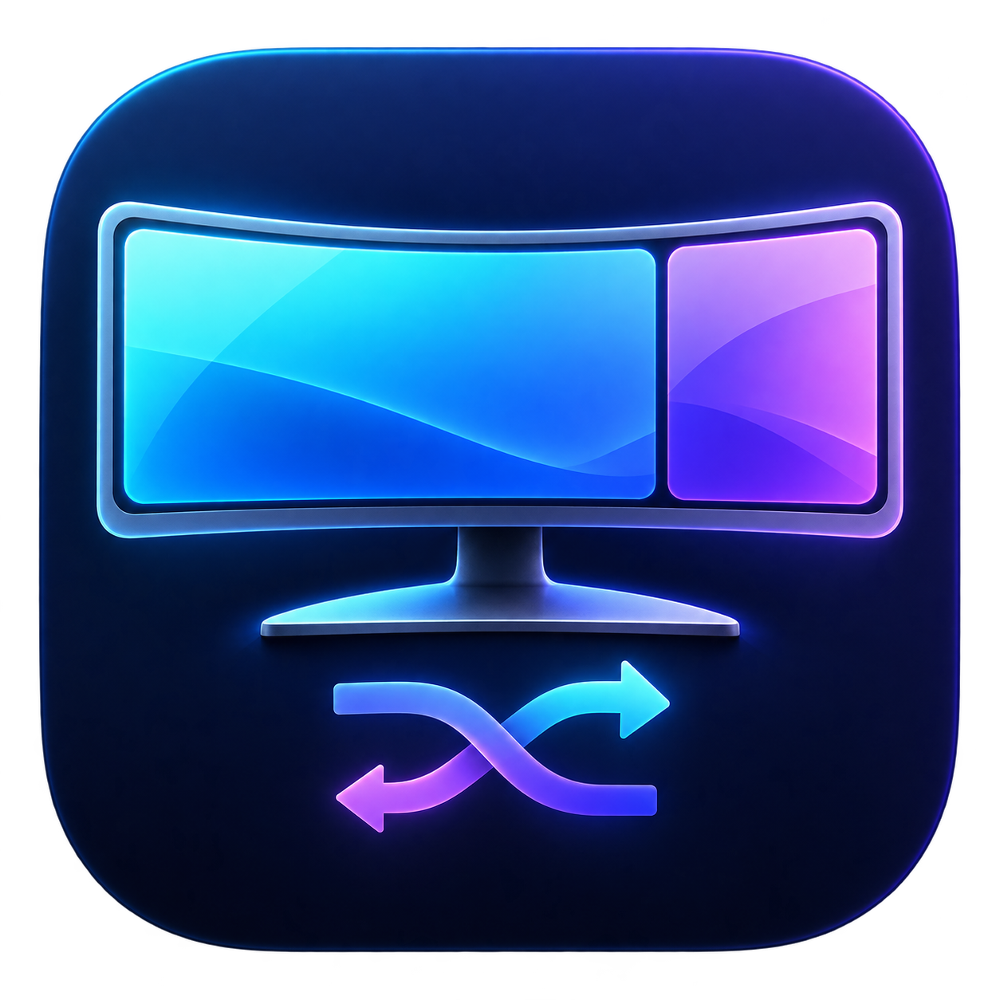

<p align="center"></p>
<h1 align="center">OpenDDPM</h1>
<p align="center">Your screen. Your way.<br>A native Mac menu bar app for Dell monitor inputs and split layouts.</p>
<p align="center"><a href="https://github.com/prBigBrother/OpenDDPM/releases/latest">Download the latest release</a> · <a href="LICENSE">MIT license</a></p>

Pick a workspace from the menu bar. Create and edit presets in a separate native
configuration window. OpenDDPM applies the monitor's real Picture-by-Picture or
Picture-in-Picture layout and assigns each video source to the correct region.

## Features

- Global hotkeys: record, change, or clear a shortcut for each preset on the Hotkeys page.
- Standalone native DDC/CI driver; no external monitor-control app required.
- Menu bar access to every saved preset, current status, and configuration.
- Visual preset editor: full screen, 50/50, 75/25, 25/75, and small/large PIP.
- DisplayPort, HDMI, and Thunderbolt input assignment.
- First-run setup discovers monitors and identifies this Mac's physical input.
- **Keep this Mac visible** blocks presets that would hide its input by default.
- Automatic configuration persistence, preset import/export, and launch at login.
- Applies only changed settings: matching presets send no writes, and layout-only changes send one layout write.
- Monitor readback verifies the resulting layout when this Mac stays visible.
- Universal binary for Apple Silicon and Intel; no Python or Homebrew required.

## Download and install

1. Download the DMG or ZIP from the [release page](https://github.com/prBigBrother/OpenDDPM/releases/latest).
2. Drag **OpenDDPM.app** to **Applications**.
3. Open OpenDDPM and use **Monitor & inputs** to discover the monitor, select the
   cable connected to this Mac, and confirm it.
4. Pick a preset from the menu bar or create your own in the configuration window.

**Release signing:** this release is ad-hoc signed and is not Apple notarized.
macOS may block a downloaded copy on first launch. After attempting to open it,
use **System Settings → Privacy & Security → Open Anyway** and confirm. Do not
disable Gatekeeper. Developer ID signing/notarization can be added when an Apple
Developer certificate is available.

## Native monitor control and hotkeys

OpenDDPM includes its own small DDC/CI driver. Apple Silicon uses IOAVService;
Intel uses IOI2CInterface. Neither transport needs another monitor-control app,
a paid license, Accessibility permission, or Input Monitoring permission.
The Apple Silicon discovery/transport implementation credits the MIT-licensed
[m1ddc](https://github.com/waydabber/m1ddc) project. See the bundled
[notice](Vendor/NativeDDC/NOTICE.md) for attribution and API limitations.

Open **Hotkeys**, click **Record…** beside a preset, then press a combination
with Command, Control, or Option. Escape cancels; **Clear** removes a binding.
Shortcuts work while another app has focus, as long as OpenDDPM is running.
Duplicate bindings are rejected and macOS registration conflicts are shown.
Presets blocked by **Keep this Mac visible** also have their hotkeys disabled.
Bindings are saved with your presets and included in preset export/import.

## Monitor support and switching behavior

The app is designed and hardware-tested with **Dell U4025QW**. Other
monitors may use different vendor-specific layout codes and are not yet supported
as validated models. Enable **DDC/CI** in the monitor's on-screen menu.

Each Mac has its own input assignment. OpenDDPM suggests the local connection
when reported by the monitor, but asks you to confirm the physical cable. Setup
does not switch the display. Preset export/import transfers layouts without
overwriting the second Mac's monitor/input setup.

Typical transitions take roughly 10–20 seconds because the monitor and macOS need
time to rediscover the display after layout/source changes. The UI remains
responsive and reports progress. The planner accounts for Dell's automatic
main/secondary source swapping and serial-targets each command because macOS
display identifiers can change with PBP layouts.

If you turn off **Keep this Mac visible**, an excluding preset prepares all writes
while retaining the local input, then hides this Mac with its final write. It
cannot promise readback or switching back over the now-hidden video connection.
Returning may require the monitor joystick or an independent USB control path.

## Build from source

Requirements: macOS and Apple's Command Line Tools, or Xcode, with Swift 5.9+.
The build has no package-manager or network dependencies. Native driver source
and its third-party license notices are included in this repository.

```sh
xcode-select --install  # if Apple's tools are not already installed
git clone https://github.com/prBigBrother/OpenDDPM.git
cd OpenDDPM
./scripts/test.sh
./scripts/build.sh
./scripts/package.sh
```

Outputs:

- `build/OpenDDPM.app` — universal, ad-hoc signed app.
- `dist/OpenDDPM-0.2.1-universal.dmg` — drag-to-Applications installer.
- `dist/OpenDDPM-0.2.1-universal.zip` — portable application bundle.
- `dist/SHA256SUMS.txt` — asset checksums.

Set `VERSION=…` when building a new version. To sign with Developer ID, set
`SIGNING_IDENTITY="Developer ID Application: …"` before building; notarize the
result using your own Apple credentials. No signing credentials are in this repo.

For a read-only native-driver smoke test:

```sh
build/OpenDDPM.app/Contents/MacOS/OpenDDPM --diagnose
```

The GitHub Actions workflow builds both architectures and runs core and packet-validation tests.
Apple Silicon DDC control has been tested on a U4025QW. The Intel transport is
compiled and packaged, but has not yet been verified on physical Intel hardware.

## Configuration and privacy

Settings live at `~/Library/Application Support/OpenDDPM/configuration.json`.
OpenDDPM discovers your monitor locally, stores your presets on your Mac, and
does not upload configuration or monitor identifiers. Release/source links open
in your browser. No account, telemetry, or remote service is required for control.

## License and credits

OpenDDPM is [MIT licensed](LICENSE). Native driver attribution and the upstream
MIT license are included under [Vendor/NativeDDC](Vendor/NativeDDC/NOTICE.md).
The generated icon's source and prompt are included under `assets/`.
OpenDDPM is independent software and is not affiliated with Dell.
